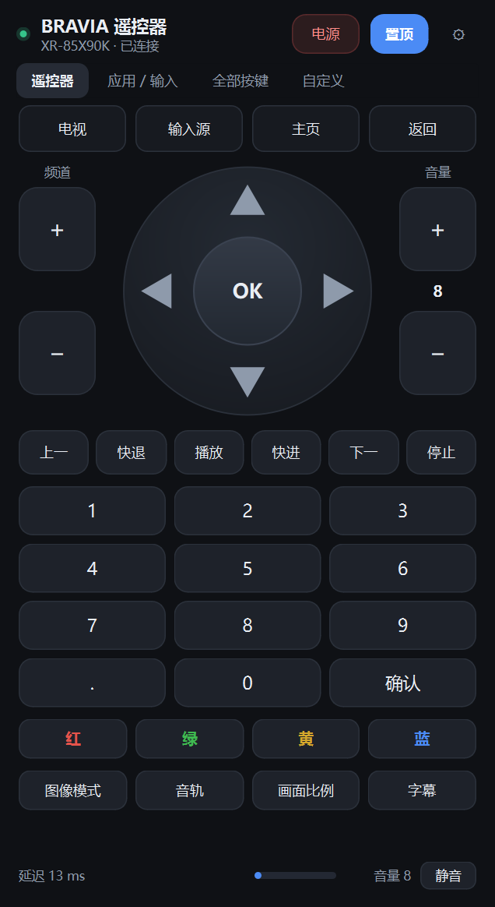

# Sony BRAVIA Remote for Windows

A tray-resident desktop remote for Sony BRAVIA TVs (2015+ / Android TV / Google TV), controlled over the local network with Sony's IP Control protocol — IRCC for key presses, JSON-REST for apps, inputs, volume and power.

局域网内控制索尼 BRAVIA 电视的 Windows 桌面遥控器。原生 IP 控制协议（IRCC + REST），覆盖电视自报的**全部官方按键**，支持自定义按键、应用直达、托盘常驻。



## 特性

- **覆盖官方遥控器全部按键**：启动时向电视索取 `getRemoteControllerInfo`，实测机型回传 **152 个按键**，全部可在「全部按键」页搜索调用；主界面按实体遥控器排布（电源/输入/方向/音量/频道/媒体/数字/彩键）。
- **托盘常驻**：关闭窗口即隐藏到右下角托盘，单击/双击呼出；托盘菜单可直接开关机、静音、调音量。
- **自定义按键**：官方按键、IRCC 原始指令、启动电视应用、在电视浏览器打开网址、多步组合宏，五种类型自由添加，右键可编辑/删除。
- **应用与输入源**：自动读取电视上已安装的应用与 HDMI 输入，点一下就在电视上打开。
- **状态回显**：实时显示电源状态、音量电平、静音状态与指令往返延迟。
- **长按连发**：音量、频道、方向键按住不放连续发送，手感与实体遥控器一致。
- **键盘操控**：方向键、回车、退格等直接当遥控器用（在输入框打字时自动让位）。
- **PIN 配对内置**：电视弹出注册提示时输入 4 位 PIN 即可，凭据落盘后不再询问；也支持预共享密钥（PSK）。

## 环境要求

- Windows 10 / 11
- Python 3.10+（仅源码运行需要）
- 电视与电脑在同一局域网，电视已开启 `设置 → 网络 → 家庭网络 → IP 控制`

## 安装

### 方式一：下载免安装 exe（推荐）

到 [Releases](../../releases) 下载 `SonyTVRemote.exe`，双击运行。首次启动会弹出设置窗口，填入电视 IP 保存即可。

### 方式二：源码运行

```bat
pip install -r requirements.txt
python run_app.py
```

### 方式三：自己打包

```bat
build_exe.bat
```

产物 `dist\SonyTVRemote.exe`，约 42 MB 单文件、免安装。

## 首次使用：完成一次配对

电视的控制类接口需要授权（只读接口是放开的）。二选一：

**A. PIN 配对（推荐，无需改电视设置）**

1. 启动程序，随便按一个键（例如「主页」）。
2. 电视屏幕上弹出「注册新设备」提示，显示 4 位 PIN。
3. 在对话框里点「开始配对」→ 填入 PIN →「完成配对」。

**B. 预共享密钥（PSK）**

电视端 `设置 → 网络 → 家庭网络 → IP 控制`：认证方式改为 `Normal and Pre-Shared Key`，自己设一个密钥；
程序端 `⚙ 设置 → 预共享密钥` 填同一个值，点「测试连接」验证。

> 建议同时开启 `远程启动`（Remote start），这样电视待机时也能收到开机指令；否则可在设置里填电视网卡 MAC，用网络唤醒开机。

## 界面与快捷键

| 页签 | 内容 |
| --- | --- |
| **遥控器** | 电视/输入源/主页/返回、方向盘、音量与频道摇杆、媒体控制、数字键盘、彩键、常用功能 |
| **应用 / 输入** | 电视已安装应用与 HDMI 输入源，点击即切换 |
| **全部按键** | 电视回传的全部按键，按 7 组分类，顶部可搜索 |
| **自定义** | 自建按键网格，右键图标可编辑或删除 |

| 按键 | 动作 | 按键 | 动作 |
| --- | --- | --- | --- |
| ↑ ↓ ← → | 方向键 | Enter | 确定 |
| Backspace / Esc | 返回 | H | 主页 |
| O | 选项 | I | 输入源 |
| M | 静音 | 空格 | 播放 / 暂停 |
| + 或 = | 音量 + | - | 音量 − |

## 自定义按键

| 类型 | 参数 |
| --- | --- |
| 官方按键 | 从下拉框选（可输入关键字过滤，如 `字幕`、`Hdmi`） |
| IRCC 原始指令 | Base64 指令，如 `AAAAAQAAAAEAAAASAw==`（音量+） |
| 启动电视应用 | 填写应用 URI，或从已读取的应用列表里选 |
| 在电视浏览器打开网址 | 如 `https://www.bilibili.com` |
| 组合宏 | 多行脚本，见下 |

宏脚本每行一步，支持 `key:` / `ircc:` / `app:` / `url:` / `delay:`：

```
key:Home
delay:600
key:Down
key:Confirm
```

## 配置文件

`%APPDATA%\SonyTVRemote\config.json`；若程序目录下存在 `config.json` 则优先使用它（便携模式）。

主要字段：`tv.host` / `tv.port` / `tv.psk` / `tv.auth_cookie` / `tv.mac` / `ui.*` / `custom_buttons`。

## 协议实现要点

这部分是踩过坑之后确认可用的做法，供二次开发参考：

| 环节 | 端点 | 要点 |
| --- | --- | --- |
| 按键 | `POST /sony/ircc` | 必须用 SOAP 信封包裹按键码（`X_SendIRCC` / `IRCCCode`），并带 `SOAPACTION` 头。直接把 Base64 当 body 发，2021+ 机型返回 **500** |
| 配对 | `POST /sony/accessControl` | `actRegister` 是标准 HTTP Basic 挑战。不带凭据调用 → `401` + `WWW-Authenticate: Basic realm="Private Page"`，电视弹 PIN；再带 `Authorization: Basic base64(":"+PIN)` 调同一请求体 → `200` + `Set-Cookie: auth=…` |
| 只读 | `/sony/system`、`/sony/audio` | `getPowerStatus`、`getVolumeInformation`、`getRemoteControllerInfo` 等无需授权 |
| 控制 | `/sony/system`、`/sony/audio`、`/sony/appControl`、`/sony/avContent` | `setPowerStatus`、`setAudioVolume`、`setActiveApp`、`setPlayContent` 需要 `auth` Cookie |

> 坑点：PIN 若只写进 JSON 参数（`params[2]`）而不放 `Authorization` 头，电视会返回 `200` 但**不签发**凭据——表现为「已完成注册但未返回授权凭据」。

## 常见问题

**提示「需要在电视上完成注册授权」/ 按键无反应**
控制接口被拒绝（401/403）。完成一次 PIN 配对，或改用 PSK。

**提示「电视接受了 PIN 但没有下发授权凭据」**
多半是上一轮配对请求仍在电视端挂起，屏幕上显示的是旧 PIN。点「开始配对」触发一个**新的** PIN 再提交。

**提示「电视没有响应」**
电视关机或不在同一网段。确认 IP（电视 `设置 → 网络 → 网络状态`）；跨网段、开了 AP 隔离都会连不上。

**应用列表为空**
应用列表接口需要授权，先完成配对，再点「刷新」。

**电视待机时开不了机**
开启 `远程启动`；或设置里填 MAC 地址并保持 IP 控制开启。

**换了电视 / 恢复出厂 / 固件升级后失效**
重新配对一次即可（设置 → 与电视配对…）。程序发现凭据失效时也会自动弹出配对框。

**想单独验证协议链路**

```bash
export SONY_TV_HOST=192.168.1.10
python tools/pair_probe.py          # 只触发配对弹窗
python tools/pair_probe.py 1234     # 用 PIN 走完整注册，并自检控制接口与 IRCC
```

## 项目结构

```
├─ run_app.py              入口
├─ 启动遥控器.bat          免命令行启动
├─ build_exe.bat           一键打包
├─ app/
│  ├─ main.py              托盘 + 单实例 + 窗口装配
│  ├─ config.py            配置读写（原子写入）
│  ├─ platform_win.py      开机自启注册表
│  ├─ core/
│  │  ├─ keys.py           官方按键表与中文标签
│  │  ├─ client.py         IRCC / REST / 配对 / WOL
│  │  ├─ service.py        业务编排与设备状态
│  │  └─ errors.py         类型化错误
│  └─ ui/
│     ├─ main_window.py    主窗口与四个页签
│     ├─ widgets.py        方向盘、摇杆、电平条等自绘控件
│     ├─ theme.py          深色主题
│     ├─ tasks.py          线程池调度
│     └─ dialogs/          设置、配对、自定义按键
├─ tools/
│  ├─ pair_probe.py        真机配对/按键诊断
│  ├─ preview.py           离屏渲染界面截图
│  └─ make_icon.py         生成多尺寸图标
└─ assets/                 图标与截图
```

分层约定：`core/client.py` 只管 HTTP 协议与错误分类，`core/service.py` 负责业务编排与状态，`ui/` 只做展示与交互；网络请求全部走后台线程池，UI 线程不阻塞；按键指令走单线程队列，连点/长按不乱序。

## 已知限制

- 语音键（`MicPressedFromPairedRC`）在官方遥控器上是蓝牙麦克风通道，IP 协议只发送按键事件，电视端不会拾音；列表里保留该键以备固件支持。
- 电视处于深度待机且未开「远程启动」时任何 IP 指令都到不了，只能靠 WOL 唤醒（需填 MAC）。
- 仅支持 Windows（托盘与开机自启使用 Win32 API）；核心协议层与平台无关，移植 macOS/Linux 只需替换 `platform_win.py` 与托盘部分。
- 未在真机上验证过的机型：协议通用，但按键表以电视回传为准，个别机型可能缺少某些键。

## 贡献

欢迎提交 Issue / PR。修改按键表请附上对应机型的 `getRemoteControllerInfo` 回传结果，便于核对。

## 许可

[MIT](LICENSE)
